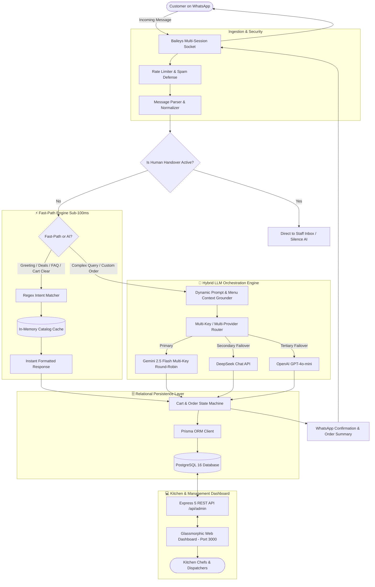
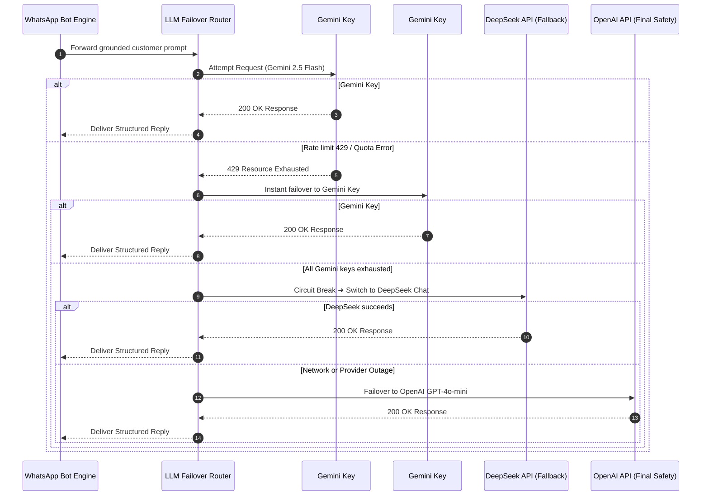

# 🍕 Cravey Crust — WhatsApp Autonomous AI Food Ordering & Kitchen Automation Platform

<p align="center">
  
  
  
  
  
  
  
  
</p>

---

## 📑 Table of Contents

- [🌟 Executive Overview](#-executive-overview)
- [⚡ Key Highlights & Core Capabilities](#-key-highlights--core-capabilities)
- [🏗️ System Architecture & Message Flow](#-system-architecture--message-flow)
- [🔄 Multi-LLM Round-Robin & Failover Engine](#-multi-llm-round-robin--failover-engine)
- [💬 Live Conversational Simulation (Roman Urdu / English)](#-live-conversational-simulation-roman-urdu--english)
- [📊 Kitchen & Admin Glassmorphic Web Dashboard](#-kitchen--admin-glassmorphic-web-dashboard)
- [📁 Repository Directory Structure](#-repository-directory-structure)
- [🚀 Quick Start & Installation](#-quick-start--installation)
  - [Prerequisites](#prerequisites)
  - [Option A: Local Native Installation](#option-a-local-native-installation)
  - [Option B: One-Click Docker Compose](#option-b-one-click-docker-compose)
  - [Option C: Production Deployment with PM2](#option-c-production-deployment-with-pm2)
- [📱 WhatsApp Connection Guide (Pairing Code & QR)](#-whatsapp-connection-guide-pairing-code--qr)
- [⚙️ Environment Variables Reference (.env)](#-environment-variables-reference-env)
- [🔌 REST API Endpoints Specification](#-rest-api-endpoints-specification)
- [🤖 Built-in WhatsApp Bot Commands](#-built-in-whatsapp-bot-commands)
- [🗄️ Database Management & Prisma ORM](#️-database-management--prisma-orm)
- [🛡️ Production Hardening & Security Best Practices](#️-production-hardening--security-best-practices)
- [❓ Frequently Asked Questions & Troubleshooting](#-frequently-asked-questions--troubleshooting)
- [🤝 Contributing & License](#-contributing--license)

---

## 🌟 Executive Overview

**Cravey Crust Full Bot** is an enterprise-grade, conversational food ordering, kitchen orchestration, and customer care platform purpose-built for high-volume restaurants, cloud kitchens, and food franchises.

Operating autonomously on **WhatsApp** via the open-source **Baileys socket engine (v6.7+)**, Cravey Crust eliminates the friction of traditional third-party food apps. Customers can browse dynamic categorized menus, customize deals and toppings, verify delivery areas, and place orders directly in their native language (**Roman Urdu, Urdu, or English**) — without ever downloading an app.

Under the hood, an intelligent **Hybrid Fast-Path & Multi-Key LLM Engine** coordinates with a **PostgreSQL (Prisma ORM)** database, an **In-Memory Catalog Cache**, and a **Real-Time Glassmorphic Kitchen Web Dashboard** to deliver sub-100ms response times, zero-latency deal lookups, and a 100% resilient ordering pipeline.

---

## ⚡ Key Highlights & Core Capabilities

| Feature Category | Technical Implementation | Business Advantage |
|---|---|---|
| **🤖 Autonomous AI Food Agent** | Fast-Path Regex Router + LLM Grounded Prompts (*"Burger Raja"*) | Zero staff overhead during peak dinner rush; 24/7 instant response. |
| **🔄 Multi-Key LLM Failover** | Automatic round-robin rotation across **Gemini**, **DeepSeek**, & **OpenAI** | 99.99% AI uptime even if Gemini quota limits or transient 429 errors occur. |
| **⚡ Sub-100ms Fast-Path** | In-memory catalog lookup & deterministic regex intent matching | Instant greeting, deal browsing, and FAQ resolution without LLM latency or cost. |
| **📦 4-Step Checkout Protocol** | Deterministic Cart State Machine (Items ➜ Name ➜ Address ➜ Payment) | Eliminates incomplete orders; prevents fake or address-less orders. |
| **📍 Smart Delivery Verification** | Polygon & radius zone engine with automatic delivery fee calculation | Eliminates out-of-boundary deliveries and incorrect fee estimations. |
| **📊 Glassmorphic Live Dashboard** | Express.js 5 + Vanilla Modern Glassmorphism SPA (No heavy build step) | Real-time kitchen Kanban order pipeline, live sales metrics, and menu tuner. |
| **📱 Multi-Account WhatsApp Hub** | Baileys multi-session auth with **8-Digit Pairing Code** & QR | Manage primary store, branch lines, and owner notifications on one server. |
| **🔀 Seamless Human Handover** | `.handover` command & real-time dashboard takeover toggle | Staff can step in anytime; AI pauses automatically for that customer. |

---

## 🏗️ System Architecture & Message Flow



---

## 🔄 Multi-LLM Round-Robin & Failover Engine

To guarantee 100% operational continuity during high-traffic restaurant operations, Cravey Crust implements a robust multi-tiered fallback mechanism:



---

## 💬 Live Conversational Simulation (Roman Urdu / English)

Here is an authentic breakdown of how Cravey Crust executes an entire order from initial greeting to kitchen handoff:

```text
[Customer]  Assalam o Alaikum, pizza deals dikhao
[CraveyBot] Wslm janab! Cravey Crust mein khush-amdeed! 🍕
            Hamari hit Pizza Deals yeh hain:
            
            1️⃣ Deal 1: 1 Regular Pizza + 1 345ml Drink — Rs. 750
            2️⃣ Deal 2: 1 Large Pizza + Garlic Bread + 1 Litre Drink — Rs. 1,450
            3️⃣ Family Feast: 2 Large Pizzas + 4 Wings + 1.5L Drink — Rs. 2,699
            
            Aapko kaunsi deal order karni hai?

[Customer]  Deal 2 kr do large fajita chicken k sath
[CraveyBot] Zabardast choice! 🍕 1x Deal 2 (Large Fajita Chicken + Garlic Bread + 1L Drink)
            aapke cart mein add ho gayi hai!
            
            Subtotal: Rs. 1,450
            
            Aapka shubh naam (Full Name) kya hai?

[Customer]  Ali Ahmed
[CraveyBot] Shukriya Ali bhai! 📍 Barahe mehrbani apna complete delivery address ya 
            WhatsApp Live Location share kar dein.

[Customer]  House 12, Street 4, Sector G-11/3, Islamabad
[CraveyBot] Perfect! Delivery Zone verify ho gaya: Sector G-11 (Delivery Fee: Rs. 150).
            
            🛒 Order Summary:
            ───────────────────────
            • 1x Deal 2 (Large Fajita)  - Rs. 1,450
            • Delivery Charges          - Rs. 150
            ───────────────────────
            Grand Total: Rs. 1,600
            
            Payment ka tariqa batayein:
            1. Cash on Delivery (COD)
            2. JazzCash
            3. EasyPaisa

[Customer]  COD
[CraveyBot] Mubarak ho Ali bhai! 🎉
            Aapka Order #CRV-8942 kitchen mein confirm ho chuka hai! 👨‍🍳
            Estimated delivery time: 35-45 minutes.
            
            Aap kisi bhi waqt '.status' likh kar tracking check kar sakte hain!
```

---

## 📊 Kitchen & Admin Glassmorphic Web Dashboard

Cravey Crust ships with a complete, zero-dependency modern web frontend located in `/public`.

<div align="center">

| Module | Description | Live Endpoint |
|---|---|---|
| 📋 **Live Kanban Board** | Real-time visual tracking (`Pending` ➜ `Confirmed` ➜ `Preparing` ➜ `Out for Delivery` ➜ `Delivered` ➜ `Cancelled`) | `/admin/orders` |
| 🍕 **Menu & Deal Manager** | Add/Edit items, prices, variants (Small, Medium, Large), toppings, and combo sets | `/admin/menu` |
| 📍 **Delivery Zone Matrix** | Configure delivery areas, boundary limits, minimum order amounts, and delivery charges | `/admin/delivery-areas` |
| 🧠 **Live Prompt Editor** | Change bot tone, rules, and promotional banners in real-time with **zero server restart** | `/admin/prompt` |
| 📱 **WhatsApp Session Hub** | Generate pairing codes, scan QR codes, monitor socket status, and manage multi-accounts | `/` (Root Dashboard) |
| 💻 **Live Terminal Stream** | Monitor incoming messages, fast-path hits, LLM latencies, and system health in real-time | `/` (Console Window) |

</div>

---

## 📁 Repository Directory Structure

```text
cravey-crust-bot/
├── commands/                     # Modular WhatsApp bot command triggers
│   ├── handover.js               # .handover & .takeover staff escalation logic
│   └── menu.js                   # .menu direct catalog print trigger
├── data/                         # Persistent operational JSON configs & prompt cache
│   └── promptConfig.json         # Runtime dynamic prompt overrides
├── downloads/                    # Ephemeral media buffers (stickers, audio, images)
├── prisma/                       # Database layer powered by Prisma ORM
│   ├── migrations/               # Production SQL migration history
│   ├── schema.prisma             # Full relational model (Orders, Carts, Menu, Zones)
│   └── seed.js                   # Database initialization script (Default menu & deals)
├── public/                       # Glassmorphic Admin Dashboard frontend
│   ├── app.js                    # SPA state management, API polling & pairing logic
│   ├── index.html                # Single-page interface structure & layout
│   └── style.css                 # Dark-mode glassmorphic theme & micro-animations
├── routes/                       # Express 5 REST API router
│   ├── admin/                    # Protected administrative management endpoints
│   │   ├── categories.js         # Menu categories CRUD
│   │   ├── customers.js          # Customer profiles & order histories
│   │   ├── dashboard.js          # High-level analytics & metrics
│   │   ├── deals.js              # Combo deals & rules engine
│   │   ├── deliveryAreas.js      # Zone pricing & boundaries
│   │   ├── faqs.js               # Knowledge base FAQ entries
│   │   ├── menu.js               # Menu item management
│   │   ├── orders.js             # Kitchen order lifecycle pipeline
│   │   ├── prompt.js             # Live AI prompt hot-reloader
│   │   ├── settings.js           # Store hours, tax rates, contact info
│   │   └── variants.js           # Sizing & attribute matrices
│   ├── internal/                 # Low-latency internal micro-endpoints
│   │   ├── cart.js               # In-flight cart calculations
│   │   ├── delivery.js           # Real-time address matching
│   │   └── pricing.js            # Dynamic price calculators
│   ├── health.js                 # Liveness & readiness probes (/health)
│   └── n8n.js                    # Webhook integration bridge (optional external automation)
├── scripts/                      # System maintenance & automation scripts
├── src/                          # Backend business logic architecture
│   ├── config/                   # Configuration registry & environment loaders
│   ├── db/                       # Prisma client instance & connection pools
│   ├── middleware/               # Auth guards, request loggers, and rate limiters
│   └── services/                 # Core engine services
│       ├── aiAgentService.js     # Prompt synthesis & LLM orchestration
│       ├── cartService.js        # Cart items, pricing, discounts, and sessions
│       ├── catalogCacheService.js# Zero-latency in-memory menu cache
│       ├── intentParser.js       # High-speed regex pattern engine
│       ├── llmRouter.js          # Multi-Key rotation & failover router
│       ├── orderService.js       # Order creation, updates, and notification dispatcher
│       └── whatsappOrderOrchestrator.js # End-to-end checkout flow orchestrator
├── utils/                        # Audio, media, sticker, and location helpers
├── bot.js                        # Main application bootstrap & Baileys socket server
├── docker-compose.yml            # Multi-container orchestration (App, Postgres, Redis)
├── Dockerfile                    # Production Node.js 20 container specification
├── package.json                  # Application dependencies and execution scripts
├── .env.example                  # Environment configuration blueprint
└── README.md                     # Comprehensive platform documentation
```

---

## 🚀 Quick Start & Installation

### Prerequisites

Ensure the following tools are installed on your host machine:
- **Node.js**: `v20.0.0` or higher (LTS recommended)
- **PostgreSQL**: `v14` or higher (or use Docker)
- **Git**
- **FFmpeg** *(Required if using sticker and audio features)*

---

### Option A: Local Native Installation

#### 1. Clone the Repository
```bash
git clone https://github.com/workwithasim/full-bot.git
cd full-bot
```

#### 2. Install Dependencies
```bash
npm install
```

#### 3. Setup Environment Variables
```bash
cp .env.example .env
```
Open `.env` in your preferred editor and configure your **Database URL**, **Gemini API Keys**, and **Dashboard Credentials**.

#### 4. Initialize Database with Prisma
```bash
# Push the Prisma schema directly to your PostgreSQL database
npx prisma db push

# (Optional) Seed the database with the default menu, pizza deals, and delivery zones
npm run db:seed
```

#### 5. Launch the Server
```bash
npm run dev
```
The server will boot up at `http://localhost:3000`.

---

### Option B: One-Click Docker Compose

Docker Compose automatically spins up the **Bot Engine**, a dedicated **PostgreSQL 16** container, and an optional **Redis** cache container with shared networks and persistent volumes:

```bash
# Build images and boot containers in background mode
docker compose up -d --build

# Monitor live container logs
docker compose logs -f app
```

To stop all containers:
```bash
docker compose down
```

---

### Option C: Production Deployment with PM2

For self-hosted Linux VPS servers (Ubuntu / Debian / AlmaLinux):

```bash
# 1. Install PM2 globally
npm install -g pm2

# 2. Run database migrations
npx prisma migrate deploy

# 3. Start application under PM2 supervisor
pm2 start bot.js --name "cravey-crust-bot"

# 4. Enable automatic restart on server reboot
pm2 startup
pm2 save
```

---

## 📱 WhatsApp Connection Guide (Pairing Code & QR)

Once your server is running, open the Admin Dashboard in your browser:
👉 **`http://localhost:3000`**

### Method 1: 8-Digit Pairing Code (Recommended — No Camera Needed)
1. Open the dashboard and locate the **Connect WhatsApp** card.
2. Enter your full WhatsApp phone number including country code without `+` or spaces (e.g. `92300XXXXXXX`).
3. Click **Get Pairing Code**.
4. An 8-digit code (e.g. `W8KJ-39LA`) will appear on your screen.
5. On your phone:
   - Open **WhatsApp** ➜ Tap **Settings (or 3 dots)** ➜ **Linked Devices**.
   - Tap **Link a Device** ➜ Tap **Link with phone number instead**.
   - Enter the 8-digit code shown on the dashboard.
6. Connection will establish in under 5 seconds!

### Method 2: High-Resolution QR Code
1. If you prefer QR scanning, leave the phone number blank or select **QR Mode**.
2. A QR code will render both on the web dashboard and inside your server terminal.
3. On your phone, open WhatsApp ➜ **Linked Devices** ➜ **Link a Device** ➜ Point camera at the QR code.

> **Session Persistence**: Sessions are saved inside the `auth/` directory. Once paired, the bot will automatically reconnect even after server restarts or network dropouts without requiring re-authentication.

---

## ⚙️ Environment Variables Reference (.env)

| Variable | Type | Default | Description |
|---|---|---|---|
| `PORT` | `Number` | `3000` | Port for Express web server and admin dashboard |
| `SERVER_IP` | `String` | `localhost` | Hostname or IP binding |
| `PREFIX` | `String` | `.` | Command prefix for bot triggers (`.menu`, `.handover`) |
| `OWNER_NUMBER` | `String` | `92300XXXXXXX` | Phone number of the restaurant owner for alerts |
| `DASHBOARD_USER` | `String` | `admin` | Username for dashboard authentication |
| `DASHBOARD_PASS` | `String` | `your_secure_password` | Password for dashboard access |
| `DATABASE_URL` | `String` | `postgresql://...` | Connection URI for PostgreSQL database |
| `STANDALONE_AI_ENABLED` | `Boolean` | `true` | Run built-in AI without external webhook dependencies |
| `AI_PRIMARY_PROVIDER` | `String` | `gemini` | Primary LLM engine (`gemini`, `deepseek`, `openai`) |
| `AI_FALLBACK_PROVIDER` | `String` | `deepseek` | Failover LLM engine if primary fails |
| `GEMINI_API_KEYS` | `String` | — | Comma-separated list of Google Gemini API keys for rotation |
| `GEMINI_MODEL` | `String` | `gemini-2.5-flash` | Gemini model identifier |
| `DEEPSEEK_API_KEYS` | `String` | — | Comma-separated list of DeepSeek API keys |
| `DEEPSEEK_MODEL` | `String` | `deepseek-chat` | DeepSeek model identifier |
| `OPENAI_API_KEYS` | `String` | — | Comma-separated OpenAI API keys |
| `OPENAI_MODEL` | `String` | `gpt-4o-mini` | OpenAI model identifier |
| `AI_TEMPERATURE` | `Float` | `0.2` | Creativity temperature for grounded restaurant ordering |
| `AI_MAX_TOKENS` | `Number` | `1024` | Maximum token length for AI completions |
| `RESTAURANT_DB_ENABLED` | `Boolean` | `true` | Enable persistent DB storage for menu & orders |
| `WHATSAPP_ORDERING_ENABLED`| `Boolean` | `true` | Master switch for WhatsApp ordering pipeline |

---

## 🔌 REST API Endpoints Specification

### Administrative Endpoints (`/api/admin`)
All admin endpoints require session authentication or `Authorization` headers.

- **`GET /api/admin/orders`**: Fetch all orders with filtering by status (`PENDING`, `PREPARING`, `DELIVERED`, etc.).
- **`PATCH /api/admin/orders/:id/status`**: Update order lifecycle state and trigger WhatsApp customer notification.
- **`GET /api/admin/menu`**: List all menu items, categories, variants, and stock availability.
- **`POST /api/admin/menu`**: Create a new menu item with pricing and image URLs.
- **`PUT /api/admin/menu/:id`**: Update existing item specs, prices, or availability.
- **`DELETE /api/admin/menu/:id`**: Soft-delete or remove a menu item.
- **`GET /api/admin/deals`**: Retrieve active combo deals, rules, and bundle pricing.
- **`GET /api/admin/delivery-areas`**: Fetch list of approved delivery zones and fee structures.
- **`GET /api/admin/prompt`**: Retrieve the currently active AI system prompt.
- **`POST /api/admin/prompt`**: Update and hot-reload the AI persona and business rules instantly.

### Internal Micro-Service Endpoints (`/api/internal`)
- **`POST /api/internal/cart/add`**: Add item and variant to customer's active cart.
- **`GET /api/internal/cart/:phone`**: Fetch current cart contents, modifiers, and subtotal.
- **`POST /api/internal/delivery/verify`**: Verify customer address against delivery zone polygons.
- **`POST /api/internal/orders/create`**: Create final order in PostgreSQL database.

### System & Health Endpoints
- **`GET /health`**: Returns JSON system health report (Socket state, DB connectivity, Memory usage, Uptime).

---

## 🤖 Built-in WhatsApp Bot Commands

| Command | Permission | Description |
|---|---|---|
| `.menu` | All Users | Instantly prints the full categorized restaurant menu with prices |
| `.status` | All Users | Checks live preparation and delivery status of the customer's latest order |
| `.handover` | All Users | Pauses AI agent and flags chat for human kitchen staff assistance |
| `.takeover` | Admin / Owner | Unpauses AI agent and resumes automated ordering |
| `.ping` | Admin / Owner | Checks bot latency and uptime metrics |
| `.mute` / `.unmute` | Admin | Temporarily silences bot responses in a specific chat |
| `.sticker` | All Users | Converts replied image or video into a WhatsApp sticker |
| `.vv` | Owner | Recovers and extracts single-view (view-once) media |

---

## 🗄️ Database Management & Prisma ORM

Cravey Crust uses **Prisma ORM** for type-safe database queries and automated schema migrations.

```bash
# Generate Prisma Client after modifying prisma/schema.prisma
npm run db:generate

# Create and apply a new migration during development
npm run db:migrate

# Apply migrations in production environments
npm run db:deploy

# Launch interactive Prisma Studio GUI (Web database browser)
npm run db:studio

# Seed or re-seed the restaurant database with fresh initial data
npm run db:seed
```

---

## 🛡️ Production Hardening & Security Best Practices

1. **Keep Secrets Out of Version Control**:
   - The `.env` file and `auth/` directory are strictly listed in `.gitignore`. Never push session credentials or secret keys to public repositories.
2. **Reverse Proxy Configuration (Nginx + SSL)**:
   - For live production deployments, place the bot dashboard behind an **Nginx** reverse proxy and terminate SSL with **Let's Encrypt Certbot**:
   ```nginx
   server {
       server_name order.yourrestaurant.com;

       location / {
           proxy_pass http://127.0.0.1:3000;
           proxy_http_version 1.1;
           proxy_set_header Upgrade $http_upgrade;
           proxy_set_header Connection 'upgrade';
           proxy_set_header Host $host;
           proxy_cache_bypass $http_upgrade;
       }
   }
   ```
3. **Change Default Admin Credentials**:
   - Immediately update `DASHBOARD_USER` and `DASHBOARD_PASS` in your `.env` before going live.

---

## ❓ Frequently Asked Questions & Troubleshooting

<details>
<summary><b>1. WhatsApp session gets logged out after some time. How to fix?</b></summary>
WhatsApp logs out inactive linked devices if the host phone doesn't connect to the internet for over 14 days. Ensure the phone hosting the WhatsApp account stays connected periodically. Also ensure the <code>auth/</code> directory has write permissions so session ratchets can persist.
</details>

<details>
<summary><b>2. How does the Multi-Key Gemini Failover work?</b></summary>
Simply supply multiple API keys separated by commas in <code>GEMINI_API_KEYS="Key1,Key2,Key3"</code>. The router rotates keys sequentially. If any key encounters a <code>429 Rate Limit</code>, it instantly retries the query on the next key without failing the customer's request.
</details>

<details>
<summary><b>3. Port 3000 is already in use (EADDRINUSE). What should I do?</b></summary>
Change the port in your <code>.env</code> file (e.g. <code>PORT=3001</code>) or kill the existing process occupying port 3000:
<pre># On Linux/macOS
lsof -i :3000 | awk 'NR>1 {print $2}' | xargs kill -9

# On Windows PowerShell
Get-Process -Id (Get-NetTCPConnection -LocalPort 3000).OwningProcess | Stop-Process
</pre>
</details>

<details>
<summary><b>4. How can I add new Pizza Deals or change prices?</b></summary>
You can edit deals directly from the <b>Web Admin Dashboard</b> at <code>http://localhost:3000</code> under the <b>Deals & Menu</b> tab, or edit <code>prisma/seed.js</code> and run <code>npm run db:seed</code>.
</details>

---

## 🤝 Contributing & License

Contributions, feature requests, and bug reports are welcome! Feel free to check the [issues page](https://github.com/workwithasim/full-bot/issues).

Distributed under the **MIT License**. See `LICENSE` for more information.

---

<p align="center">
  <b>Cravey Crust AI Food Ordering Platform</b> • Built with ❤️ for Next-Gen Restaurant Automation
</p>
