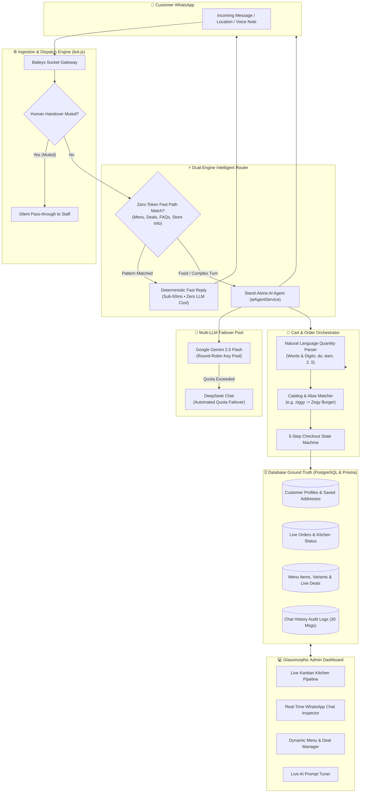
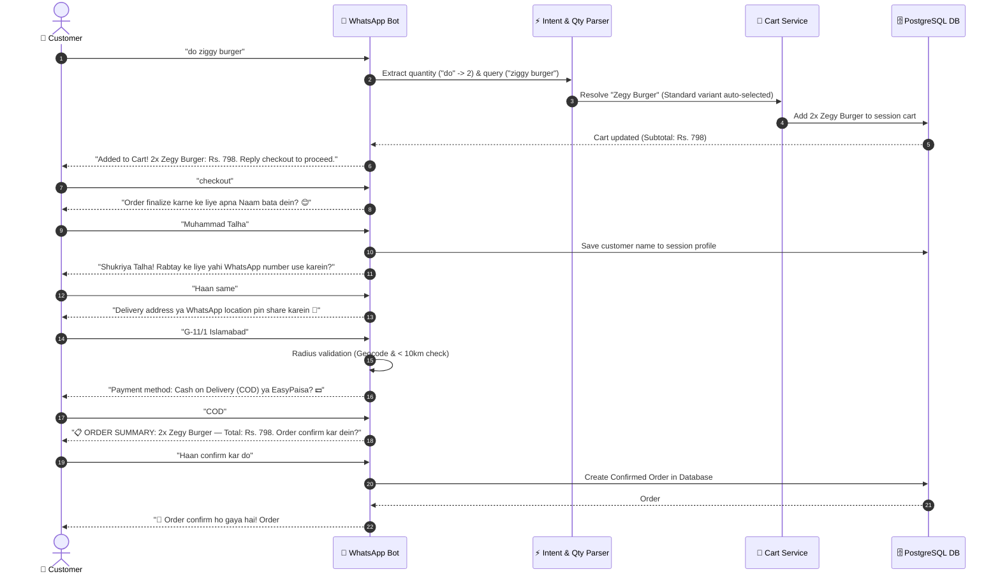
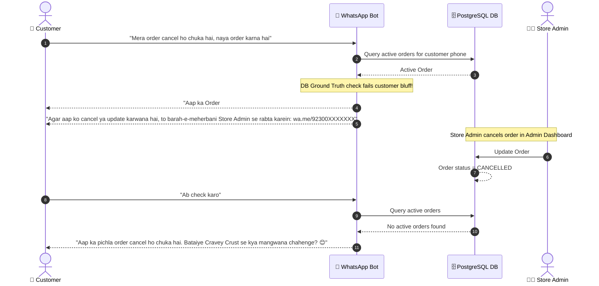

<div align="center">

# 🍕 Cravey Crust — WhatsApp Autonomous AI Ordering & Enterprise Restaurant Platform

### *Next-Generation Autonomous Food Ordering Engine, Zero-Token Fast Path Architecture & Glassmorphic Restaurant Management Suite*

[](https://nodejs.org/)
[](https://github.com/WhiskeySockets/Baileys)
[](https://ai.google.dev/)
[](https://www.prisma.io/)
[](#-admin-dashboard-modules)
[](LICENSE)

[Key Innovations](#-key-innovations--enterprise-features) • [System Architecture](#-system-architecture) • [Workflow Diagrams](#-system-workflows--sequence-diagrams) • [Quick Start](#-quick-start) • [Environment Setup](#-environment-configuration-env) • [Production Deployment](#-production--vps-deployment) • [REST API](#-rest-api-overview)

---

</div>

## 🌟 Executive Summary

**Cravey Crust** is a production-hardened, enterprise-grade WhatsApp food ordering ecosystem built for modern cloud kitchens, pizzerias, and multi-branch restaurant franchises.

Unlike basic chatbots or rigid button-based menus, Cravey Crust integrates a **hybrid intelligent architecture**:
1. **Sub-50ms Zero-Token Fast-Path Routing**: Instantly satisfies deterministic requests (greetings, dynamic category menus, multi-page deal flyers, and FAQs) with zero LLM API cost.
2. **Autonomous Multi-LLM Agent**: Features automated round-robin rotation across Google Gemini (`gemini-2.5-flash`) and DeepSeek with automatic quota failover.
3. **Database Ground Truth Protection**: Strictly verifies live database states to prevent order cancellation bluffing and hallucinatory order status updates.
4. **Natural Language Roman Urdu & Urdu Understanding**: Recognizes word-based quantities (`aik`, `do`, `teen`, `char`, `panch`), standalone food requests (`2 zinger burger`, `do ziggy burger`) without requiring action suffixes like *"kar dein"*, and auto-resolves colloquial aliases.
5. **Real-Time Glassmorphic Control Center**: Full-fledged kitchen queue Kanban board, menu manager, customer chat audit logging with CSV exports, delivery radius matrix, and in-browser prompt editor.

---

## ⚡ Key Innovations & Enterprise Features

### 🍔 Standalone Direct Ordering (Zero Action Suffix Required)
- **Direct Add to Cart**: Customers can simply text `"2 zinger burger"`, `"do ziggy burger"`, `"5 hot wings"`, `"2 loaded fries"`, or `"1 behari roll"`.
- **No Verb Dependency**: The bot eliminates legacy restrictions where users had to append *"kar dein"* or *"order kar do"*. 
- **Urdu & Roman-Urdu Word Numbers**: Built-in bilingual parser maps written words (`aik`, `ek`, `do`, `doo`, `teen`, `tin`, `char`, `chaar`, `panch`, `paanch`, `chay`, `saat`, `aath`, `nau`, `dus`) straight into integer quantities.
- **Intelligent Catalog Alias Resolution**: Auto-maps colloquial terms (e.g., `"ziggy burger"` ➜ `"Zegy Burger"`, `"hot wings"` ➜ `"Hot Wings"`). Single-variant items with a `Standard` portion are added immediately without redundant size clarification prompts.

### 🛡️ Database Ground Truth & Anti-Bluffing Order Engine
- **Tamper-Proof Order Status**: If a customer claims *"Mera order cancel ho chuka hai"* or asks to update an existing order, the bot **never assumes cancellation based on user claims alone**.
- **Live DB Verification**: Queries PostgreSQL for the latest active order (`PENDING`, `CONFIRMED`, `PREPARING`, `READY`, `OUT_FOR_DELIVERY`).
- **Store Admin Bridge**: If an order is still active, the bot politely clarifies that store admin has not yet marked it cancelled in the system, and generates a direct WhatsApp link to the Store Admin for resolution.

### 👤 Returning Customer Persistence & Anti-Hallucination
- **Persistent Profiles**: Customer name, phone number, and delivery addresses are automatically saved to PostgreSQL.
- **One-Tap Re-confirmation**: When a returning customer orders again, their saved address is recalled (e.g. *"Aap ka saved Delivery Address: House 123... mojood hai. Kya isi par proceed karein?"*).
- **Zero Address Loops**: Eliminates repetitive address questioning once confirmed by the customer.

### 📋 Strict 5-Step Checkout Protocol
The state machine strictly guides customers one step at a time without overwhelming them:
- **Step 1 — Customer Name**: Captured and verified against spam / feedback filter lists.
- **Step 2 — Contact Phone Confirmation**: Verifies whether to use the current WhatsApp number or an alternate contact.
- **Step 3 — Delivery Address & Radius Check**: Accepts text addresses or live WhatsApp location pins, verified against OpenStreetMap coordinates and the 10km store radius.
- **Step 4 — Payment Method**: Dynamically offers enabled payment modes (**COD** or **EasyPaisa**).
- **Step 5 — Order Summary & Confirmation**: Displays line items, discounts, and order total for final explicit approval before triggering order creation.

### 🧠 30-Message Conversation Memory Window
- Retains up to **30 contextual messages** across chat turns, allowing customers to ask follow-up questions, modify quantities, and switch between items without losing context.

### 🤝 Human Handover & Support Muting Protocol
- Automatic detection of human support requests (e.g., *"manager se baat karwao"*, *"agent chahiye"*).
- Instant **120-minute silent mute** for AI responses so staff can handle customer support directly via WhatsApp Web or mobile, with seamless `.takeover` command to resume automation.

---

## 🏗️ System Architecture



---

## 🔄 System Workflows & Sequence Diagrams

### 1. Standalone Direct Ordering & 5-Step Checkout Flow



---

### 2. Live Order Verification & Anti-Bluffing Cancellation Flow



---

## 🛠️ Technology Stack

| Domain | Technology | Description |
|---|---|---|
| **Runtime Environment** | **Node.js (v20+ LTS)** | High-throughput asynchronous event loop |
| **HTTP Web Server** | **Express.js v5.2** | Modern REST API backend with JSON streaming support |
| **WhatsApp Engine** | **`@whiskeysockets/baileys` (v6.7)** | Robust WebSocket multi-device pairing & media transmission |
| **Relational Database** | **PostgreSQL 16** | ACID-compliant persistent operational datastore |
| **Object-Relational Mapping** | **Prisma ORM v5.22** | Type-safe migrations, seeding, and dynamic queries |
| **Primary AI Engine** | **Google Gemini 2.5 Flash** | Multi-turn reasoning, tool calling, and high tokens/sec |
| **Fallback AI Engine** | **DeepSeek Chat (`deepseek-chat`)** | Cost-effective failover for unhindered 24/7 uptime |
| **Admin Dashboard UI** | **Vanilla ES6+ & CSS3 Glassmorphism** | Zero-dependency, ultra-fast SPA with Light/Dark modes |
| **Image & Media Engine** | **Sharp & Fluent-FFmpeg** | Real-time image optimization and audio voice transcoding |
| **Process Management** | **PM2 / Docker Compose** | Automated restarts, clustering, and health monitoring |

---

## 📊 Admin Dashboard Modules

The Cravey Crust control center is a zero-latency, single-page application built with custom CSS glassmorphism and modern UI components:

| Module | Features & Capabilities |
|---|---|
| **📋 Dashboard** | Live revenue metrics, today's order count, average ticket size, and quick navigation |
| **📦 Orders (Kanban)** | Visual pipeline across `Pending`, `Confirmed`, `Preparing`, `Ready`, `Out for Delivery`, `Delivered`, and `Cancelled` |
| **🍔 Menu Items** | Real-time catalog editor: add/edit items, set base prices, assign multiple size variants, toggle availability |
| **📁 Categories** | Category ordering, slug assignment, and image banner attachments |
| **🎁 Meal Deals** | Complex bundle builder with multi-item inclusions, discounts, and validity periods |
| **📍 Delivery Areas** | Geofence matrix: boundary rules, base delivery fees, and minimum order thresholds |
| **👥 Customers** | Customer CRM: order counts, total spend, saved delivery addresses, and single-click data wipe |
| **💬 Customer Chats** | Real-time conversation inspector, message stream auditor, and export tools (CSV / JSON / TXT) |
| **❓ FAQ / Knowledge** | Dynamically indexed Q&A knowledge base powering automated zero-token replies |
| **🤖 Bot Prompt Tuner** | In-browser prompt editor allowing instant modifications to AI persona, tone, and active offers |
| **⚙️ Settings** | Business hours, payment gateway details (EasyPaisa / COD), tax percentages, and WhatsApp socket control |

---

## 🚀 Quick Start Guide

### Prerequisites
- [Node.js](https://nodejs.org/) `>= 20.0.0`
- [PostgreSQL](https://www.postgresql.org/) `>= 14` (Local installation or Docker container)
- [Git](https://git-scm.com/)

### 1. Clone the Repository
```bash
git clone https://github.com/muhammadokashapak/development-craveycrust.git
cd development-craveycrust
```

### 2. Install Dependencies
```bash
npm install
```

### 3. Configure Environment Variables
Create your local `.env` configuration file from the template:
```bash
cp .env.example .env
```
Update your database connection string and API keys (see [Environment Configuration](#-environment-configuration-env)).

### 4. Database Setup & Seeding
```bash
# Push Prisma schema to your PostgreSQL database
npx prisma db push

# Seed default Cravey Crust categories, menu items, deals, and settings
npm run db:seed
```

### 5. Launch Application
```bash
# Run in development mode
npm run dev
```

Open your browser at:
👉 **`http://localhost:2146`** (or your configured `PORT`)

---

## 📱 WhatsApp Pairing & Authentication

Cravey Crust supports two convenient connection methods via the **WhatsApp Bot** tab in the Admin Dashboard:

```text
┌─────────────────────────────────────────────────────────────┐
│  WhatsApp Authentication Methods                            │
├───────────────────────────────┬─────────────────────────────┤
│ Method 1: 8-Digit Pairing Code│ Method 2: QR Code Scanning  │
├───────────────────────────────┼─────────────────────────────┤
│ 1. Enter your phone number    │ 1. Navigate to WhatsApp tab │
│    with country code          │ 2. Open WhatsApp on phone   │
│    (e.g., 923001234567)       │ 3. Go to Linked Devices     │
│ 2. Click "Get Pairing Code"   │ 4. Scan the rendered QR code│
│ 3. Enter the 8-digit code on  │                             │
│    your WhatsApp device       │                             │
└───────────────────────────────┴─────────────────────────────┘
```

> [!NOTE]
> Authentication sessions are encrypted and stored in `auth/sessions/`. The bot automatically re-establishes socket connection upon server reboot or network interruptions.

---

## ⚙️ Environment Configuration (.env)

| Variable | Default | Description |
|---|---|---|
| `PORT` | `2146` | HTTP port for the Express server and Admin Dashboard |
| `SERVER_IP` | `localhost` | Host IP for internal API callbacks |
| `DATABASE_URL` | `postgresql://...` | PostgreSQL connection string |
| `STANDALONE_AI_ENABLED` | `true` | Activates autonomous dual-engine AI orchestrator |
| `AI_PRIMARY_PROVIDER` | `gemini` | Primary AI provider (`gemini` or `deepseek`) |
| `AI_FALLBACK_PROVIDER` | `deepseek` | Secondary failover AI provider |
| `GEMINI_API_KEYS` | `""` | Comma-separated Google Gemini API keys for quota rotation |
| `GEMINI_MODEL` | `gemini-2.5-flash` | Gemini model tag |
| `DEEPSEEK_API_KEYS` | `""` | Comma-separated DeepSeek API keys |
| `DEEPSEEK_MODEL` | `deepseek-chat` | DeepSeek model identifier |
| `AI_TEMPERATURE` | `0.2` | Low temperature for grounded, non-hallucinatory replies |
| `OWNER_NUMBER` | `""` | Primary owner phone number with country code |
| `DASHBOARD_USER` | `admin` | Admin dashboard username |
| `DASHBOARD_PASS` | `cravey@admin2026` | Admin dashboard password |
| `AUTH_SECRET` | `""` | 64-character secret for signing JWT admin session tokens |

---

## 🌐 Production & VPS Deployment

### Option 1: PM2 Process Supervision (Recommended)
```bash
# Install PM2 globally
npm install -g pm2

# Deploy database migrations
npx prisma migrate deploy

# Start the bot process
pm2 start bot.js --name "cravey-crust"

# Save process list for automatic reboot startup
pm2 startup
pm2 save
```

### Option 2: Docker & Docker Compose
```bash
# Build and run containers in detached mode
docker compose up -d --build

# View container logs
docker compose logs -f app
```

### Option 3: Nginx Reverse Proxy with SSL (Hostinger / Ubuntu)
```nginx
server {
    listen 80;
    server_name bot.craveycrust.com;

    location / {
        proxy_pass http://127.0.0.1:2146;
        proxy_http_version 1.1;
        proxy_set_header Upgrade $http_upgrade;
        proxy_set_header Connection 'upgrade';
        proxy_set_header Host $host;
        proxy_cache_bypass $http_upgrade;
        proxy_set_header X-Real-IP $remote_addr;
        proxy_set_header X-Forwarded-For $proxy_add_x_forwarded_for;
    }
}
```
Obtain free HTTPS certificate via Certbot:
```bash
sudo certbot --nginx -d bot.craveycrust.com
```

---

## 🔌 REST API Overview

### Admin APIs (`/api/admin`)

| Endpoint | Method | Description |
|---|---|---|
| `/api/admin/orders` | `GET` | Retrieve paginated order list with status filters |
| `/api/admin/orders/:id/status` | `PATCH` | Transition order status (`PREPARING`, `READY`, etc.) |
| `/api/admin/orders/purge-all` | `POST` | Delete all orders with safety confirmation |
| `/api/admin/menu` | `GET`, `POST` | Fetch catalog / Add new menu item |
| `/api/admin/menu/:id` | `PUT`, `DELETE` | Update item details or soft-delete item |
| `/api/admin/menu/delete-all` | `POST` | Wipe all menu items from database |
| `/api/admin/categories/delete-all`| `POST` | Purge all categories and nested items |
| `/api/admin/deals/delete-all` | `POST` | Purge all active meal deals |
| `/api/admin/delivery-areas` | `GET`, `POST` | Manage approved delivery zones and fees |
| `/api/admin/chats/conversations` | `GET` | Inspect live customer WhatsApp conversations |
| `/api/admin/chats/export` | `GET` | Export customer chat history to CSV / TXT |
| `/api/admin/prompt` | `GET`, `POST` | Read or update the live AI system prompt |

---

## 🧪 Developer Testing & Verification Suite

The repository includes comprehensive automated test suites to verify deterministic intent parsing, quantity extraction, alias resolution, and end-to-end conversation flows:

```bash
# 1. Run Comprehensive Order & Quantity Regression Tests
node scratch/run_order_tests.js

# 2. Run Full End-to-End Customer Conversation Simulation
node scratch/simulate_chat.js

# 3. Clear In-Memory Catalog Cache
npm run clear-cache
```

---

## 📁 Repository Directory Structure

```text
development-craveycrust/
├── bot.js                          # Application entry point, Express server & Baileys socket gateway
├── data/                           # Dynamic runtime overrides and fallback configurations
├── prisma/
│   ├── schema.prisma               # Relational database models (Orders, Items, Deals, Settings)
│   └── seed.js                     # Seed catalog data for Cravey Crust
├── public/                         # Modern Glassmorphic Admin Dashboard SPA
│   ├── app.js                      # Client-side state management & live API controllers
│   ├── index.html                  # Responsive multi-tab dashboard layout
│   └── style.css                   # Glassmorphic design system (Light & Dark themes)
├── routes/
│   ├── admin/                      # Secure admin endpoints (orders, menu, deals, chats, settings)
│   └── internal/                   # Internal microservice APIs for cart and geocoding
├── src/
│   ├── config/
│   │   ├── systemPrompt.js         # Grounded AI agent prompt template & business guardrails
│   │   └── env.js                  # Environment variable schema validation
│   ├── db/
│   │   └── client.js               # Prisma database client with connection pooling
│   └── services/
│       ├── aiAgentService.js       # Multi-LLM runner with Gemini/DeepSeek rotation
│       ├── intentParser.js         # Zero-token fast routing, regex matching & intent parsing
│       ├── menuService.js          # Dynamic catalog resolution, size & alias matching
│       ├── orderService.js         # Order lifecycle, DB ground truth checks & admin alerts
│       ├── cartService.js          # In-memory and persistent cart state machine
│       ├── sessionService.js       # Customer session tracking and 30-message history window
│       └── whatsappOrderOrchestrator.js # End-to-end conversational order coordinator
└── utils/                          # Geocoding, location math, and media handling helpers
```

---

## 🤝 Contributing & License

Contributions, bug reports, and pull requests are warmly welcome!

Distributed under the **MIT License**. See [`LICENSE`](LICENSE) for terms.

<div align="center">
  <sub>Built with ❤️ for <b>Cravey Crust</b> • Enterprise Conversational AI & Food Automation</sub>
</div>
